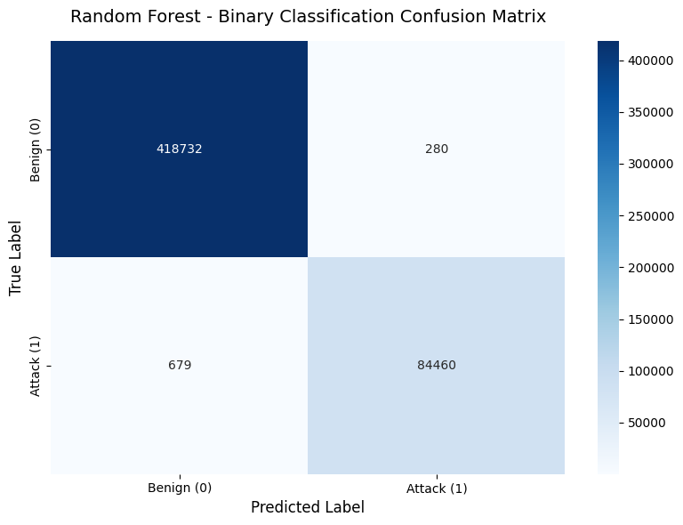

# Intrusion Detection System

## Project Overview
This project focuses on detecting network intrusions using machine learning classification techniques. The goal is to classify network activity as normal or attack.

## Dataset
- **Dataset:** CICIDS 2017
- **Learning Type:** Supervised Learning
- **Task:** Binary Classification
- **Classes:** Normal and Attack

## Technologies Used
- Python
- Pandas
- NumPy
- Scikit-learn
- Matplotlib
- Seaborn
- Google Colab
- Jupyter Notebook

## Project Implementation
The project uses machine learning algorithms to classify network traffic. The workflow includes data cleaning, feature scaling, feature selection, model training, and evaluation.

Model evaluation includes an 80/20 train-test split and 10-fold cross-validation experiments.

## Model Comparison

The following results are recorded in the notebook's saved outputs:

| Model | Accuracy | Precision (Attack) | Recall (Attack) | F1-score (Attack) |
|---|---:|---:|---:|---:|
| Random Forest | 99.81% | 99.67% | 99.20% | 99.44% |
| Logistic Regression | 94.15% | 85.27% | 79.02% | 82.03% |
| Linear SVM | 94.52% | 86.46% | 80.10% | 83.16% |
| Decision Tree | 99.87% | 99.58% | 99.66% | 99.62% |
| Naive Bayes | 59.13% | 29.04% | 98.41% | 44.85% |

**Note:** These are recorded experimental results. Performance may vary with data preparation and evaluation methodology.

## Project Notebook
The complete implementation and analysis are available in the Jupyter Notebook uploaded to this repository.

## Confusion Matrix

The confusion matrix below shows the Random Forest model's binary classification results on the test dataset.

## How to Run
1. Clone or download this repository.
2. Open the `.ipynb` notebook in Google Colab or Jupyter Notebook.
3. Obtain the CICIDS 2017 dataset from its original source.
4. Update the dataset file path in the notebook to match your environment.
5. Install the required libraries listed in `requirements.txt`.
6. Run the notebook cells in order.

## Limitations
- The model's high accuracy should be interpreted carefully.
- Data preprocessing and feature selection occur before the train-test split in the current workflow, which may introduce data leakage.
- Cross-dataset evaluation shows that strong performance on one dataset does not necessarily guarantee effective attack detection on another dataset.

## Author
**Parv Patial**
